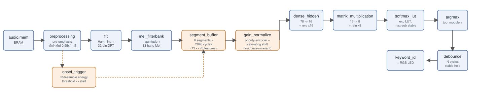
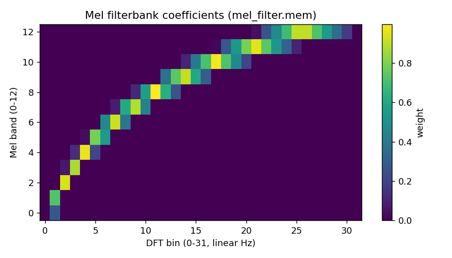
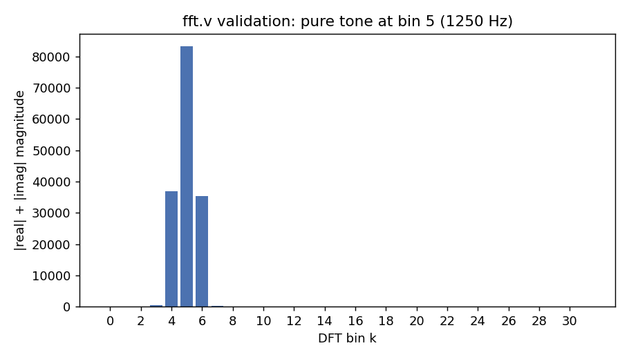
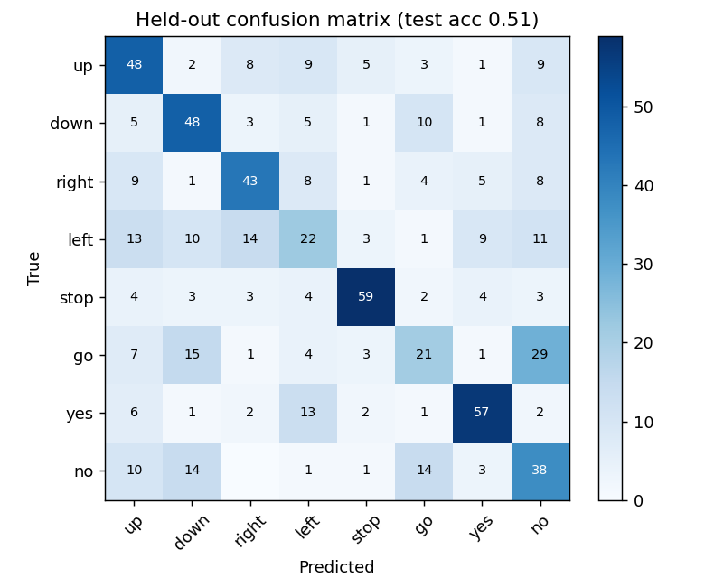
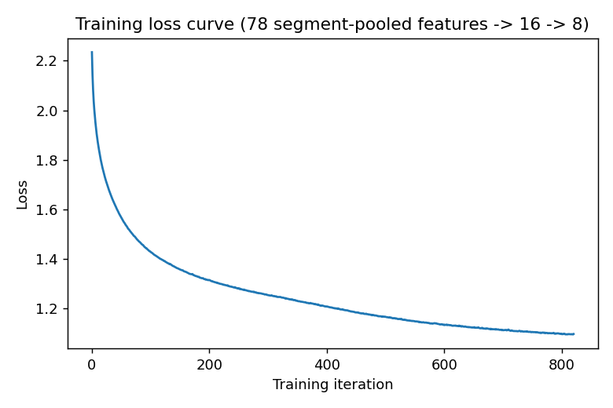

# Hear-it-Right

A speech keyword-recognition pipeline implemented directly in Verilog for
the Digilent Cora Z7 (Zynq-7000), from raw PCM audio in BRAM through to a
10-keyword classification shown on an RGB LED. No vendor IP blocks or HLS -
every stage (DSP and neural network both) is hand-written RTL.

## Pipeline

```
audio.mem (BRAM) --> preprocessing --> fft --> mel_filterbank -->
  segment_buffer --> dense_hidden --> relu (x16) --> matrix_multiplication -->
  relu (x8) --> softmax_lut --> argmax --> debounce --> keyword_id / RGB LED
```

| Stage | Module | What it does |
|---|---|---|
| 1 | `preprocessing.v` | Streams 16-bit PCM samples out of a BRAM-backed buffer (`audio.mem`, 21760 samples / ~1.36s at 16kHz) and applies first-order pre-emphasis (`y[n] = x[n] - 0.95*x[n-1]`) to boost high frequencies before analysis. |
| 2 | `fft.v` | Maintains a 16-tap sliding analysis window, applies a Hamming window, then computes a direct-form DFT (`X[k] = sum_n w[n]*x[n]*e^{-j2*pi*k*n/16}`) over 8 positive-frequency bins. Outputs real part (bins 0-7) and imaginary part (bins 0-7) on the same 16 output ports. |
| 3 | `mel_filterbank.v` | Converts each (real, imaginary) bin pair to a magnitude estimate (`\|re\| + \|im\|`), then applies a 13-band triangular Mel filterbank (`mel_filter.mem`, generated by `scripts/generate_mel_filter.py`) to produce 13 Mel features per sample. |
| 4 | `segment_buffer.v` | Pools the streaming per-sample Mel output into 6 segments of ~2048 cycles each (a window long enough to span a spoken word), giving the classifier 78 features (6 segments x 13 bands) that capture how the word's spectrum evolves over time, instead of 13 features describing only the current instant. |
| 5 | `dense_hidden.v` | First classifier layer: 78 segment-pooled Mel features -> 16 hidden units (`hidden_weights.mem` / `hidden_biases.mem`). |
| 6 | `relu.v` (x16) | Hidden-layer ReLU activation. |
| 7 | `matrix_multiplication.v` | Second classifier layer: 16 hidden units -> 8 class scores (`weights.mem` / `biases.mem`). |
| 8 | `relu.v` (x8) | Output-layer ReLU activation. |
| 9 | `softmax_lut.v` | Converts the 8 class scores to probabilities via a precomputed exponential lookup table (`softmax_lut.mem`), with max-subtraction for numerical stability. |
| 10 | `top_module.v` | Argmax over the 8 probabilities selects `raw_keyword_id`. |
| 11 | `debounce.v` | Holds a classification steady for `DEBOUNCE_TIME` clock cycles before it's accepted, filtering out rapid flicker between classes. |

All fixed-point arithmetic is Q1.15 (signed 16-bit, `>>>15` rescale after a
multiply) for weights/activations and Q8 (`>>>8`) for Mel filter
coefficients.

## Output mapping

`keyword_id` (4 bits) drives both an output port and the Cora Z7's onboard
RGB LED (`led_r`, `led_g`, `led_b`):

| `keyword_id` | Keyword | LED |
|---|---|---|
| 0 | Up | Off |
| 1 | Down | Red |
| 2 | Right | Green |
| 3 | Left | Blue |
| 4 | Stop | Yellow |
| 5 | Go | Cyan |
| 6 | Yes | Magenta |
| 7 | No | White |

The classifier only has 8 output classes, so `keyword_id` values 8 (reserved,
blinking red) and 9 (reserved, blinking green) in `top_module.v`'s LED case
statement are unreachable with the current layer sizes - kept for a future
10-class classifier.

## FPGA setup (Digilent Cora Z7)

`constraints.xdc` maps the design to these pins:

| Signal | Pin | Function |
|---|---|---|
| `clk` | K17 | 100MHz onboard oscillator |
| `rst` | D19 | BTN0 |
| `led_r` / `led_g` / `led_b` | M14 / N15 / L14 | Onboard RGB LED (LD4) |
| `keyword_id[3:0]` | Y19 / Y16 / Y17 / W14 | PMOD JB |

Build with Vivado using the included `tcl` script (`opt_design` ->
`place_design` -> `phys_opt_design` -> `route_design`), or run it
interactively: create a project targeting the Cora Z7, add all `.v` files
and `constraints.xdc`, then run synthesis, implementation and generate a
bitstream as usual.

## Simulating

Every module has its own testbench. With [Icarus
Verilog](http://iverilog.icarus.com/):

```bash
# Any single stage, e.g. the DFT
iverilog -o fft.vvp fft_tb.v fft.v
vvp fft.vvp

# The full pipeline
iverilog -o top.vvp top_module_tb.v top_module.v preprocessing.v fft.v \
    mel_filterbank.v segment_buffer.v dense_hidden.v matrix_multiplication.v \
    relu.v softmax_lut.v debounce.v
vvp top.vvp
```

`$readmemh` loads every `.mem` file relative to the simulator's working
directory, so run these from the repo root.

## Regenerating the `.mem` files

- **`scripts/generate_mel_filter.py`** builds `mel_filter.mem` from a
  standard Mel-scale triangular filterbank formula, sized for the hardware's
  actual bin/band count (`--bins`/`--bands`).
- **`scripts/init_weights.py`** writes default-initialized
  `hidden_weights.mem` / `hidden_biases.mem` / `weights.mem` / `biases.mem`.
- **`scripts/decimal_to_hex_mem.py`** converts a plain signed-decimal `.mem`
  file (one value per line) to the 16-bit hex format `$readmemh` actually
  requires.
- **`scripts/extract_features.py`** reproduces the hardware's exact signal
  path (pre-emphasis -> Hamming window -> DFT -> magnitude -> Mel
  filterbank -> segment pooling) in floating-point Python/numpy, for
  inspecting features outside simulation. `extract_segments` matches
  `segment_buffer.v` exactly: it pads or truncates a clip to a fixed-length
  window, then mean-pools each of 6 equal chunks of frames separately.
- **`scripts/train.py`** trains the two-layer classifier on a directory of
  labeled recordings and exports the result straight to the `.mem` layout
  above:

  ```bash
  python scripts/train.py data/ --classes up down right left stop go yes no
  ```

  expects `data/<keyword>/*.wav` (16kHz mono 16-bit PCM) for each of the 8
  classes above. Internally it standardizes the 78 segment-pooled features
  before training, folding that back into the hidden layer's weights
  afterward so the exported `.mem` files still expect raw, unstandardized
  input - raw filterbank output is badly scaled for gradient descent on a
  network this small, and standardizing it measurably improves training.

## Diagrams and training results



The 13-band Mel filterbank actually used by `mel_filterbank.v` (generated by
`scripts/generate_mel_filter.py`):



`fft.v`'s direct-form DFT validated against a synthetic 4687.5Hz tone, which
lands exactly on bin 3 of the 16-tap, 8-bin transform - the magnitude output
peaks at bin 3 as expected:



The shipped `hidden_weights.mem` / `hidden_biases.mem` / `weights.mem` /
`biases.mem` are real weights from `scripts/train.py`, trained on 3276
real clips (roughly 400 per class) of the
`up`/`down`/`right`/`left`/`stop`/`go`/`yes`/`no` keywords from the
[Speech
Commands](https://huggingface.co/datasets/pollen-robotics/speech-commands-v0.02)
dataset, run through the exact feature pipeline `extract_features.py`
mirrors from the hardware (including `segment_buffer.v`'s 6-segment
pooling - see the Pipeline table above). Held-out accuracy on an
80/20 split is 0.512 (vs. 0.125 for random guessing across 8 classes).
Confusion matrix and training loss curve for that run:




Earlier versions of this classifier mean-pooled a whole ~1s clip into a
single 13-feature vector before classifying it, which capped held-out
accuracy at around 0.36 regardless of how much training data or how
elaborate the training method (standardization, knowledge distillation
from a bigger teacher model) was thrown at it. That ceiling tracks a
documented failure mode in small-footprint keyword-spotting literature:
Zhang et al.'s "Hello Edge: Keyword Spotting on Microcontrollers" points
out that plain DNNs trained on pooled or flattened per-frame features
discard local temporal correlation that convolutional/recurrent models
exploit. `segment_buffer.v` is this project's hand-written-RTL answer to
that - not a conv/recurrent layer, but enough of a sliding temporal
window (6 segments instead of 1) to roughly double held-out accuracy
with no other change to the training method.

An 8-way classifier built from a 13-band Mel/8-bin DFT front end and a
78→16→8 MLP is still a tight budget for real speech - the point of this
project is the hand-written RTL pipeline end-to-end (BRAM to LED), not
state-of-the-art keyword spotting accuracy. More segments, a richer
front end, or a bigger hidden layer (all just module/`.mem` size
parameters) would likely push accuracy further.

## License

MIT - see [LICENSE](LICENSE).
